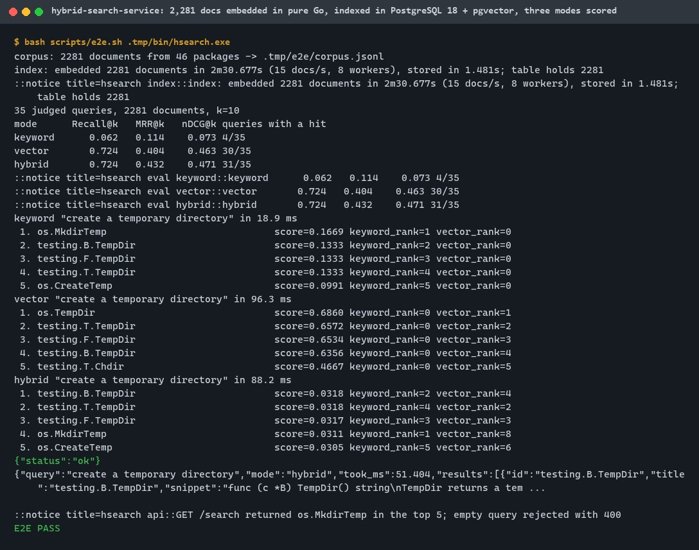
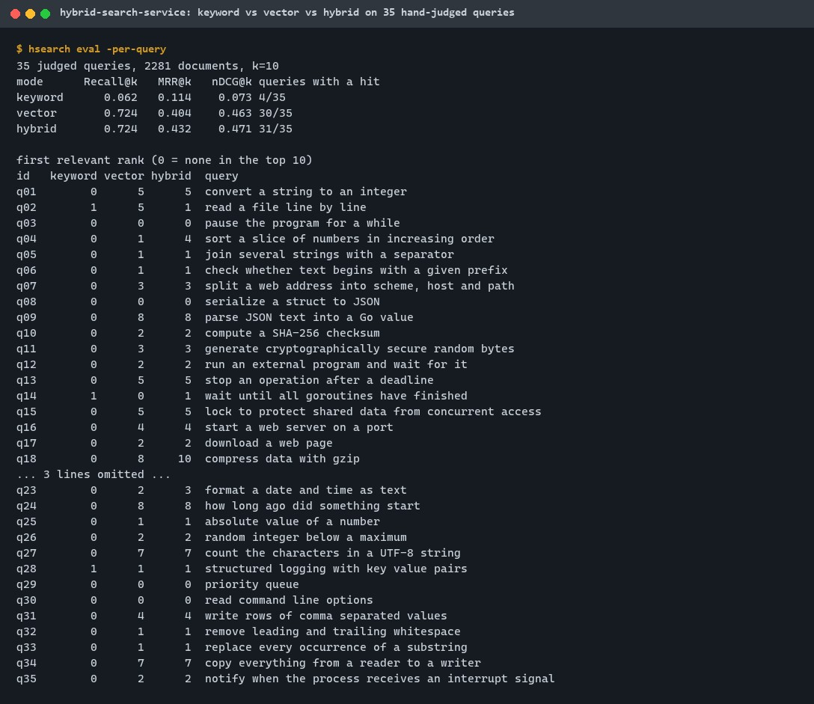
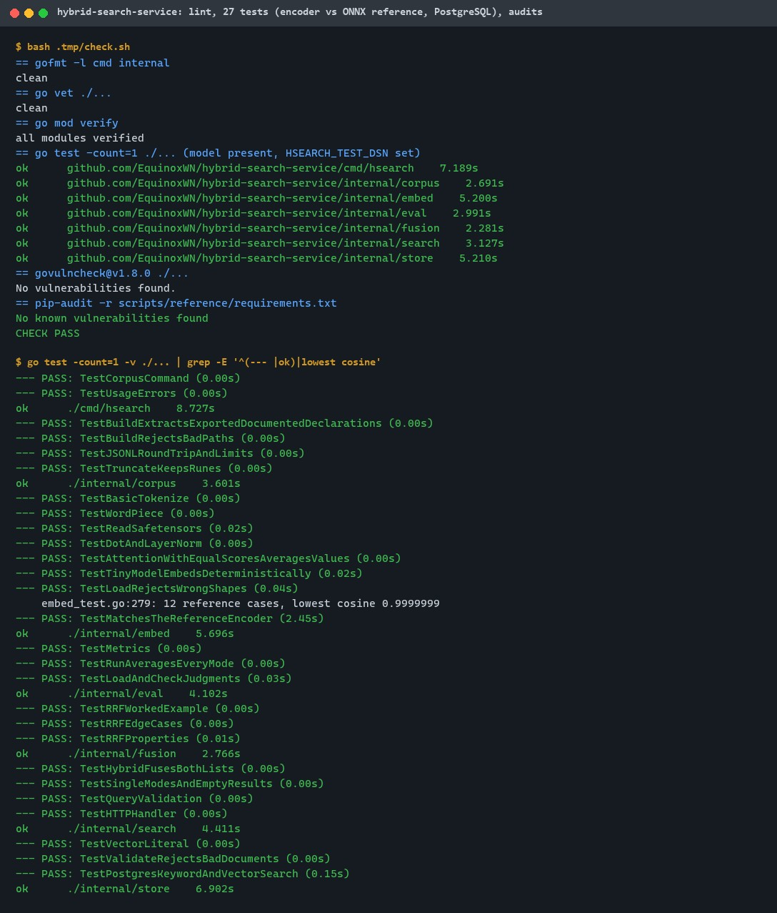
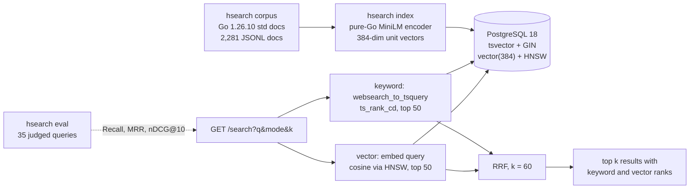
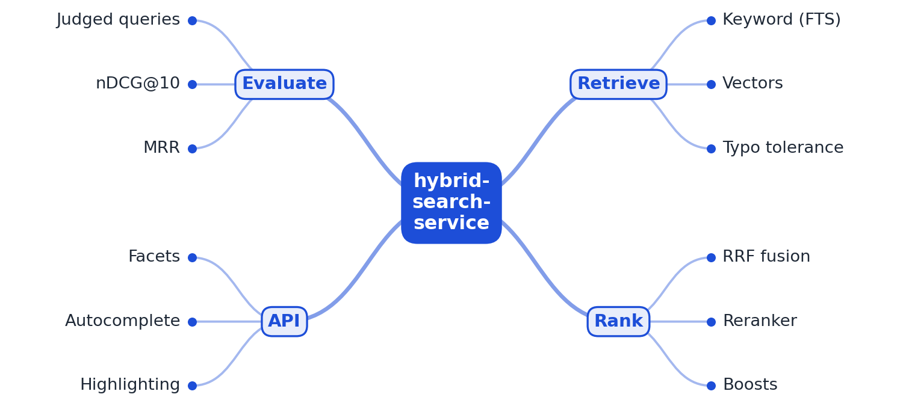

# hybrid-search-service

[](https://github.com/EquinoxWN/hybrid-search-service/actions/workflows/ci.yml)


> Search that finds what people mean, not just what they typed, and proves it with real relevance scores.

Part of my **Backend and API** list · Go

## Proof it works

2,281 documentation entries from the Go standard library are embedded by a pure-Go
all-MiniLM-L6-v2 encoder and indexed in PostgreSQL 18 (full-text search and pgvector). On 35
natural-language queries judged by the author, keyword search finds a relevant result in the top
10 for 4 queries, vector search for 30 and hybrid search (reciprocal rank fusion of both) for 31,
with the best nDCG@10 (0.471). The HTTP API answers and rejects bad input:



Per-query ranks show where hybrid helps (keyword matches lift q02, q14, q22) and where it costs
places (q04, q18, q23):



27 tests passed at M1 (31 since the [2026-11-01 quality pass](docs/quality/2026-11-01.md)), including the encoder against the official ONNX export (identical tokens, cosine
0.9999999) and the PostgreSQL tests; govulncheck and pip-audit find nothing:



## Architecture

**What M1 runs today:**



**Full roadmap (M1 to M3):**



## How it works

_Steps 1 and 2 are built and tested (M1); the rest is on the [roadmap](#roadmap)._

1. Documents are indexed for keyword search and embedded as vectors with pgvector.
2. Each query runs both searches, and reciprocal rank fusion merges the two result lists.
3. A cross-encoder reranks the top 50 results.
4. About 200 judged queries score every configuration with nDCG@10 and MRR.
5. Meilisearch is scored on the same set as a baseline.
6. The API adds facets, autocomplete and highlighting.

In M1 every document gets a generated `tsvector` column (title weighted above body, dots in
identifiers split) with a GIN index, and a 384-dimension embedding with an HNSW index. A hybrid
query runs the keyword search while the query is embedded, fetches the top 50 of each, and scores
each document by the sum of 1/(60 + rank) over the lists it appears in, so the two incomparable
score scales never have to be mixed.

## Who it helps

- **Who:** backend engineers adding search to a product that already runs PostgreSQL, and people
  learning how keyword, vector and hybrid retrieval compare.
- **The problem:** users describe what they want in their own words; keyword search misses those
  queries, vector search misses exact names, and a second search engine is one more system to run.
- **What M1 does:** keyword and vector retrieval in the same PostgreSQL table, fused with RRF
  behind one HTTP endpoint, with an embedding model that runs inside the Go binary (no Python, no
  cgo, no external API) and an evaluator that scores every mode on judged queries.
- **How to use it:** point `HSEARCH_DSN` at PostgreSQL with pgvector, run `hsearch index` on a JSONL
  file of `{id, title, body}`, then `hsearch serve` and call `GET /search?q=...&mode=hybrid`.
  Write a judged query file for your own data and run `hsearch eval` before trusting any mode.

## Tech stack

| Area | In M1 | Planned |
|---|---|---|
| Storage | PostgreSQL 18, generated `tsvector` + GIN, pgvector 0.8.7 `vector(384)` + HNSW (cosine), pgx v5 | |
| Embeddings | all-MiniLM-L6-v2 in pure Go: safetensors loader, BERT tokenizer, transformer, mean pooling; checked against ONNX Runtime | Cross-encoder reranker (M2) |
| Ranking | `websearch_to_tsquery` + `ts_rank_cd`; cosine top-k; reciprocal rank fusion (k = 60) | Reranking of the top 50 (M2) |
| Evaluation | 35 author-judged queries, Recall@10, MRR@10, nDCG@10, per-query ranks | 200 judged queries (M2), Meilisearch baseline (M3) |
| API | `GET /search`, `GET /healthz`, loopback by default, bounded inputs, timeouts | Facets, autocomplete, highlighting (M3) |
| Quality | gofmt, go vet, 31 tests (race detector in CI), govulncheck, pip-audit, CI with a pgvector container | |

Language: **Go 1.26**; Python only for the optional reference fixture.

| Path | What it is |
|---|---|
| `cmd/hsearch` | CLI: `corpus`, `index`, `query`, `serve`, `eval` |
| `internal/embed` | Pure-Go sentence encoder and tokenizer |
| `internal/store` | PostgreSQL schema, upserts, keyword and vector queries |
| `internal/fusion` | Reciprocal rank fusion |
| `internal/search` | Modes, hybrid orchestration, HTTP handler |
| `internal/eval` | Judged-query metrics |
| `internal/corpus` | Standard-library documentation corpus |
| `testdata` | Judged queries; encoder reference fixture |
| `scripts` | Model download, local PostgreSQL + pgvector, end-to-end run, reference generator |

## Run it

Needs Go 1.26+, make, bash with curl, and PostgreSQL with pgvector. On Windows without Docker,
`make pg-setup` downloads PostgreSQL 18.6 and builds pgvector 0.8.7 into `.tmp/` (needs Visual
Studio Build Tools); elsewhere use any PostgreSQL 18 with pgvector, for example the
`pgvector/pgvector:0.8.7-pg18` image. Everything else stays in `.tmp/` (git-ignored).

```bash
make setup                      # go mod download and verify
make model                      # all-MiniLM-L6-v2 at a pinned revision, SHA-256 checked
make pg-setup && make pg-start  # Windows only: local PostgreSQL 18 + pgvector on 127.0.0.1:54329
export HSEARCH_DSN="postgres://postgres@127.0.0.1:54329/hsearch?sslmode=disable"
make lint && make test          # tests; set HSEARCH_TEST_DSN for the PostgreSQL tests
make audit                      # govulncheck
make e2e                        # corpus, index (about 2.5 min), eval, API
make clean-model && make pg-stop
```

Step by step:

```bash
make build
.tmp/bin/hsearch corpus -goroot "$(go env GOROOT)"
.tmp/bin/hsearch index
.tmp/bin/hsearch query -mode hybrid "read a file line by line"
.tmp/bin/hsearch eval -per-query
.tmp/bin/hsearch serve -addr 127.0.0.1:8080   # curl "localhost:8080/search?q=sleep&k=5"
```

## Tests and results

Latest local run (full detail in [docs/results/m1.md](docs/results/m1.md)):

| Test file | Tests | What it proves |
|---|---|---|
| `internal/embed/embed_test.go` | 8 | Tokenizer rules, WordPiece, safetensors bounds, math kernels, a tiny model end to end, shape checks, and identical tokens plus cosine 0.9999999 against the ONNX reference |
| `internal/fusion/rrf_test.go` | 4 | Worked example, edge cases, 500 random property checks, equal scores ordered by best single rank |
| `internal/store/store_test.go` | 4 | Input validation; connection attempts bounded (10 s unless the DSN sets `connect_timeout`); against PostgreSQL + pgvector: schema, upsert, keyword and vector search, hostile query |
| `internal/search/search_test.go` | 5 | Fusion of both lists, single modes, validation (a query of exactly 512 bytes accepted), HTTP status codes and headers, no leaked errors |
| `internal/eval/eval_test.go` | 3 | Metrics, per-mode averages, judged-file validation (an empty file refused), missing judgments refused |
| `internal/corpus/corpus_test.go` | 4 | Declarations extracted, platform files excluded, bad paths, JSONL limits |
| `cmd/hsearch/main_test.go` | 3 | Corpus errors, usage errors, non-loopback listen addresses refused |

| Check | Result |
|---|---|
| Tests | 27 passed, 0 failed, 0 skipped at M1 (model and test database present); 31 since the quality pass (29 locally without the model and database, all 31 in CI) |
| Lint | gofmt, go vet: clean |
| Audit | govulncheck v1.8.0 (Go 1.26.10): no vulnerabilities; pip-audit (reference stack): none |
| Keyword / vector / hybrid, nDCG@10 on 35 queries | 0.073 / 0.463 / **0.471** |
| Queries with a relevant result in the top 10 | 4 / 30 / **31** of 35 |
| OR-ed keyword terms instead (ADR 0003) | keyword 0.208, hybrid 0.405: not adopted |
| Indexing | 2,281 documents embedded in 2 min 15 s to 2 min 31 s (8 goroutines) |
| Single-query latency | keyword 9 to 20 ms, hybrid 46 to 88 ms including query embedding |

The judged set is small and written by the author in natural language, which favours vector
search; differences of a few points are within its noise. CI runs lint, tests with the race
detector against a pgvector container, govulncheck and the end-to-end run on every push.

## Roadmap

**M1** (≈8 h)
- [x] Write `docs/rfc/0001-design.md`: problem, goals, non-goals, chosen design
- [x] Documents are indexed for keyword search and embedded as vectors with pgvector.
- [x] Each query runs both searches, and reciprocal rank fusion merges the two result lists.

**M2** (≈8 h)
- [ ] A cross-encoder reranks the top 50 results.
- [ ] About 200 judged queries score every configuration with nDCG@10 and MRR.

**M3** (≈9 h)
- [ ] Meilisearch is scored on the same set as a baseline.
- [ ] The API adds facets, autocomplete and highlighting.
- [ ] Publish the proof below with real numbers

Started early in M1: a 35-query judged set and the evaluator, which M2 extends to about 200 queries.

## Proof

What this repo must show before it counts as done:

- An nDCG table: keyword vs vector vs hybrid vs reranked.

| Result | Value |
|---|---|
| nDCG@10, 35 author-judged queries | keyword 0.073, vector 0.463, hybrid 0.471; reranked: not built yet (M2) |

## Why it matters

- **Interview angle:** 'Design search and typeahead with good relevance'.
- **Upstream I'd like to contribute to:** pgvector or Meilisearch.

## Design docs

- [RFC 0001: design](docs/rfc/0001-design.md)
- [ADR 0001: record architecture decisions](docs/adr/0001-record-architecture-decisions.md)
- [ADR 0002: embed text with a pure-Go encoder, checked against ONNX Runtime](docs/adr/0002-pure-go-embedding-encoder.md)
- [ADR 0003: require every query term in the keyword list that feeds fusion](docs/adr/0003-strict-keyword-list-for-fusion.md)
- [M1 results](docs/results/m1.md)
- [Quality check 2026-11-01](docs/quality/2026-11-01.md): the ten quality rules with evidence and a mutation table

## Scope

This is a learning and portfolio system, not a hosted production service. Everything runs
locally; the API listens on loopback only.

## Security and contributing

- All SQL is parameterised; queries are limited to 512 bytes and k to 1..50; backend errors are
  returned as a generic `500`; the server refuses non-loopback listen addresses and sets timeouts.
- The model, PostgreSQL zip and pgvector source are pinned by SHA-256; the CI database image is
  pinned by digest; every GitHub Action is pinned to a commit SHA; workflows run read-only,
  without persisted credentials.
- Model files are deleted after each run (`make clean-model`); the results doc records how to fetch them again.
- Dependabot update pull requests are paused (`open-pull-requests-limit: 0`) so the repository keeps a single `main` branch; dependencies are updated by hand and checked by the CI audit.
- gofmt, `go vet` and the race detector on every push; `govulncheck` (`make audit`) in CI.
- Report vulnerabilities privately: see [SECURITY.md](SECURITY.md). To contribute, see [CONTRIBUTING.md](CONTRIBUTING.md).

## License

MIT, see [LICENSE](LICENSE).
